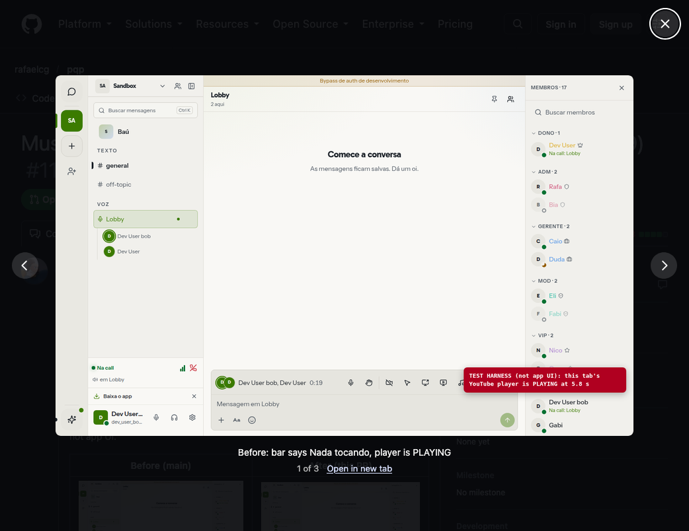

# Glance

A tiny Firefox extension that opens GitHub pull request and issue screenshots in a modal. The page stays where it is.



No toolbar button, no settings, no accounts. It does not send the page address or the image anywhere else.

## Features

- A normal click on a screenshot opens it over the pull request or issue
- Escape, or a click on the dark area, closes it
- Arrow keys move between screenshots in the same comment
- Click the image to see it at full size
- Command-click, Control-click, Shift-click, and middle-click still open the file

## Install

Zen and Firefox both refuse an unsigned add-on until signature checks are off.

1. Open `about:config`.
2. Set `xpinstall.signatures.required` to `false`.
3. Leave that setting false. If you turn it back on, the browser disables this add-on.

### Download

1. Grab `Glance.xpi` from the [latest release](https://github.com/AndreCamm/Glance/releases/latest).
2. Open `about:addons`.
3. Open the gear menu. Choose **Install Add-on From File**.
4. Select the `.xpi` file.
5. Reload any open GitHub tabs.

### Build from source

```
git clone https://github.com/AndreCamm/Glance.git
cd Glance
./build.sh
```

The packed file is `dist/Glance.xpi`. Install it with the steps above.

You can also load the folder as a temporary add-on. Open `about:debugging#/runtime/this-firefox`, click **Load Temporary Add-on**, and select `manifest.json`. That copy lasts until you quit the browser.

## Using it

Open a pull request or issue that contains a screenshot, and click the image.

GitHub turns those screenshots into links to `raw.githubusercontent.com`. A normal click opens that file in a new tab. This add-on keeps you on the page.

**Nothing happens when I click.** Reload the GitHub tab. The add-on only attaches to pages that load after it is installed.

**I want the file anyway.** Command-click the screenshot, or use **Open in new tab** in the modal.

## How it works

On GitHub, a screenshot in a pull request is an image inside a link:

```html
<a href="https://raw.githubusercontent.com/.../before.png">
  
</a>
```

The add-on listens for a plain left click on that kind of link. It cancels the navigation and opens the image that is already on the page. Links that are not images, including badges such as "Open in Cursor", are left alone.

Screenshots in the same comment share one modal, so a before and after pair can be stepped through with the arrow keys.

## Requirements

- Zen Browser, or Firefox 142 or later
- `xpinstall.signatures.required` set to `false` for a permanent install

## Check

```
node test/links.test.mjs
```

## Contributing

Issues and pull requests are welcome. The click rules live in [`lib/links.js`](lib/links.js), and the modal lives in [`content.js`](content.js). The aim is to keep it small and single purpose.

## License

[MIT](LICENSE)
